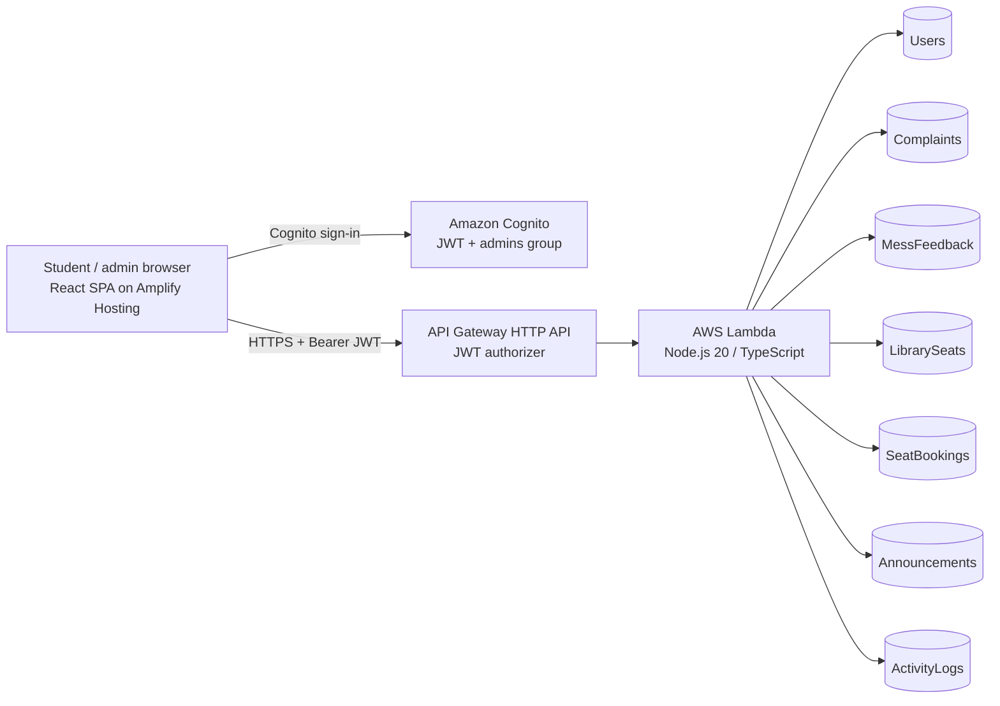

# CampusConnect

**One Campus. One Platform. Smarter Solutions.**
A responsive campus-services platform for Techfest IIT Bombay × AWS ShipIt Challenge 2026.

> **Honest deployment status:** Source code and infrastructure are prepared locally. No AWS account, resources, GitHub repository, or public deployment were provided or created. There is no live project URL yet. Local demo mode works without cloud credentials; the AWS path is real, but requires deployment and your own AWS/Cognito configuration. The optional AWS seed fixture records carry a `demo: true` marker and the UI labels a seeded cloud dataset.

## 1. Problem and solution

Students often have no clear way to report hostel Wi-Fi failures, provide actionable mess feedback, check library seating, or keep up with campus updates. CampusConnect places these everyday tasks in a unified, role-aware interface with status tracking and a focused campus-operations view.

### Objectives

- Let a student report and track a Wi-Fi issue.
- Collect meal-level 1–5 ratings with one rating per student / meal / UTC day.
- Show library seating, make conflict-safe expiring reservations, and manage unbooked maintenance states.
- Publish categorized campus announcements.
- Give authorized administrators complaint controls and operational analytics.
- Demonstrate Cognito, API Gateway, Lambda and DynamoDB as actual, deployable cloud components.

## 2. Features

- **Student space:** dashboard, personal Wi-Fi requests, meal ratings, library layout / booking / cancellation, announcements, profile.
- **Campus admin:** separate navigation, complaints across campus, status changes and resolution notes, create/edit/delete notices, analytics charts.
- **Accessible feedback:** validated forms, status pills, toast messages, empty states, loading/error handling, mobile drawer, light/dark theme.
- **Local demo:** fictional data persisted in browser `localStorage`, student and admin demo roles. It is visibly labelled `LOCAL DEMO` and is not presented as cloud authentication or storage.
- **AWS mode:** real Cognito sign-in/email verification, API Gateway JWT authorizer, Lambda APIs, DynamoDB queries and transactional seat booking. Cloud mode is enabled only when the frontend has API + Cognito configuration.

**Not in this scope:** S3 attachments, SNS messages, push/email notifications, or a live location/seat sensor feed. No fake upload, notification or live AWS integration is displayed. Library inventory is seeded on deployment; seat bookings then persist and serialize in DynamoDB.

## 3. Technology

| Layer | Implementation |
|---|---|
| UI | React 18, TypeScript, Vite 8, Tailwind CSS v4 utilities + responsive CSS, Lucide, Recharts 3, React Router 7 |
| Forms / auth | Native constraint validation + server validation; AWS Amplify Auth for Cognito |
| API | API Gateway HTTP API, JWT authorizer, one Node.js 20 Lambda in TypeScript |
| Persistence | Seven DynamoDB tables; on-demand billing, GSI query patterns, conditional writes / transaction |
| IaC | AWS SAM / CloudFormation (`infrastructure/template.yaml`) |
| Hosting | AWS Amplify Hosting deployment procedure (connect a Git branch in the Amplify console) |
| Tests | Vitest, validation and handler authorization / request behavior tests |

## 4. AWS architecture



Full trust boundaries and operations: [`docs/architecture.md`](docs/architecture.md). Database keys / query patterns: [`docs/database-design.md`](docs/database-design.md). HTTP contract: [`docs/api.md`](docs/api.md).

## 5. Repository map

```text
CampusConnect-AWS-ShipIt-2026/
├── frontend/                 React app, pages, styles, AWS Auth/API adapter
├── backend/                  Lambda handler, validation, seed utility, tests
├── infrastructure/
│   ├── template.yaml         Cognito, API, Lambda, seven DynamoDB tables
│   └── budget-alert.yaml     Optional email budget alert (separate opt-in)
├── docs/                     Architecture, API, DB, deploy, test, demo docs
├── tests/                    Submission verification checklist
├── .env.example
├── frontend/.env.example
└── README.md
```

## 6. Local development (verified instructions)

Prerequisites: Node.js 20+, npm 10+. At repository root:

```bash
npm install
npm run dev
```

Open the Vite URL (normally `http://localhost:5173`). Choose **Sign in**, enter any valid email and a password of at least 8 characters, then choose Student or Admin. This is a browser-only demo session; there is no password verification in local demo mode. Seeded names are invented examples. App actions (complaints, ratings, seats, announcements) work and persist in local browser storage. Use a separate browser profile / clear site data for a clean walkthrough.

```bash
npm run build       # frontend production build + backend TypeScript compile
npm test            # backend handler/validation tests + frontend data tests
npm run lint        # TypeScript strict checks in both workspaces
```

Production build output is generated at `frontend/dist` (ignored by Git). No AWS resources are required for local demo mode. See `docs/testing-report.md` for the actual test status recorded after running commands.

## 7. Environment configuration

For AWS mode copy `frontend/.env.example` to `frontend/.env.local`. Values come from the deployed stack outputs; they are identifiers, not credentials:

```dotenv
VITE_API_URL=https://<api-id>.execute-api.ap-south-1.amazonaws.com/v1
VITE_COGNITO_USER_POOL_ID=ap-south-1_<pool-id>
VITE_COGNITO_CLIENT_ID=<public-no-secret-app-client-id>
VITE_COGNITO_REGION=ap-south-1
```

Do not put access keys, secret keys, private app-client secrets, or user passwords in Vite variables. Vite variables are compiled into browser JavaScript. The Cognito app client is public by design and has no client secret. Keep `frontend/.env.local` out of Git.

## 8. AWS deployment guide

Deployment is **not** executed by this workspace. It creates cloud resources and may incur charges. Review pricing/Free Tier, set a budget alert and obtain account-owner approval before running these steps. Suggested region: `ap-south-1` (Mumbai) for a Maharashtra campus; verify every service in your AWS account's current regional availability before deployment.

### 8.1 Check account and cost first

- Review [AWS Free Tier / current account offers](https://aws.amazon.com/free/) and the [serverless offer details](https://aws.amazon.com/free/serverless/). AWS's current offers are account/plan dependent and may be credits or time-limited; do not assume all services are permanently free.
- Review [API Gateway pricing](https://aws.amazon.com/api-gateway/pricing/), [DynamoDB pricing](https://aws.amazon.com/dynamodb/pricing/), [Lambda pricing](https://aws.amazon.com/lambda/pricing/), [Cognito pricing](https://aws.amazon.com/cognito/pricing/), and [Amplify pricing](https://aws.amazon.com/amplify/pricing/).
- As checked against AWS's current Free Tier page on **21 Nov 2026**, AWS advertises signup credits / a limited trial and individual service allowances; API Gateway currently describes one million calls per month per API type for up to 12 months. Eligibility can depend on account creation date/plan and region. This is not a guarantee of a $0 bill. DynamoDB uses on-demand billing in this template; AWS's free DynamoDB allowance and on-demand charge treatment must be checked for the specific account and region. Lambda invocations, data transfer, storage, logs, Cognito MAUs and static hosting may also have billable overages.
- The stack intentionally avoids a NAT Gateway, VPC, EC2 instance, DynamoDB provisioned capacity, S3 upload bucket, and always-on service. Still, **pay-per-request is not the same as zero cost**.
- Configure an AWS Budget + email alerts. The optional `infrastructure/budget-alert.yaml` proposes a $5 example threshold; set a real email and amount, and deploy the budget stack in the appropriate billing/home region after checking its behavior. Alerts can be delayed and do not cap spending.

### 8.2 Required tools / account permissions

Install AWS CLI v2 and AWS SAM CLI; configure your own IAM Identity Center / named profile with permission to create CloudFormation, Cognito, API Gateway, Lambda, DynamoDB, IAM roles/policies, and CloudWatch log groups. Never paste credentials into source code or chat. Use an account-owned profile and confirm the region:

```bash
aws sts get-caller-identity --profile <your-profile>
aws configure get region --profile <your-profile>
```

### 8.3 Build and deploy the backend

1. Build and validate locally first:

```bash
npm ci
npm run build
sam validate --lint --template-file infrastructure/template.yaml
```

2. Create an Amplify Hosting app/branch (console) from your Git repository, set build command `npm ci && npm run build --workspace frontend`, artifact directory `frontend/dist`, and SPA rewrite to `/index.html` (200). Amplify build-time environment variables can be set after the backend stack outputs are available. Do not turn on a paid feature unless you have reviewed its charge.

3. Obtain the final Amplify `https://...amplifyapp.com` origin, then package/deploy backend with that exact allowed origin:

```bash
sam build --template-file infrastructure/template.yaml
sam deploy --guided \
  --template-file .aws-sam/build/template.yaml \
  --stack-name campusconnect-shipit-2026 \
  --region ap-south-1 \
  --capabilities CAPABILITY_IAM \
  --parameter-overrides AllowedOrigin=https://<your-branch>.<your-app>.amplifyapp.com
```

The guided prompt uploads the SAM artifact to an S3 deployment bucket, which can incur small storage/transfer costs. Review the change set and IAM permissions before confirming. **Do not confirm if AWS shows unexpected paid resources.** The CloudFormation stack contains Cognito, API Gateway, Lambda, seven on-demand DynamoDB tables and Lambda IAM/log resources.

4. Record `ApiBaseUrl`, `CognitoUserPoolId`, `CognitoAppClientId`, and `CognitoRegion` outputs. Put them only into Amplify's frontend environment settings (or local `.env.local`); set `VITE_API_URL` to the full API output including `/v1`.

5. Rebuild/redeploy the Amplify app after setting variables. Add a test account through the signup page, verify its email, and sign in. To authorize an administrator, first verify the real person's identity, then use the Cognito console to add only that account to the `admins` group. Never register an admin by frontend parameter or trust a role stored in browser storage.

6. Seed the library layout and explicitly fictional sample notices/complaints/ratings (optional):

```bash
# Set names from stack outputs, and use the same AWS profile/region as deployment.
export SEATS_TABLE='<SeatsTableName stack output>'
export ANNOUNCEMENTS_TABLE='<AnnouncementsTableName stack output>'
export COMPLAINTS_TABLE='<ComplaintsTableName stack output>'
export FEEDBACK_TABLE='<FeedbackTableName stack output>'
AWS_PROFILE=<your-profile> AWS_REGION=ap-south-1 npm run build --workspace backend
AWS_PROFILE=<your-profile> AWS_REGION=ap-south-1 npm run seed --workspace backend
```

Seeded complaint/feedback owners are fictional placeholders, not Cognito accounts, and do not count as registered users. They are visible to admins; demo seed never uses real student data. Seed also reserves eight seats as sample occupancy.

7. Verify from the public HTTPS URL: sign-up email confirmation, real student login, unauthorized admin endpoint rejection, complaint write and read persistence, duplicate feedback rejection, two-user collision on one seat, cancellation, admin-only notice/status changes, reload persistence, CORS and mobile layout. Put the *verified* URL in README only after this succeeds.

### 8.4 Updating and deleting resources

- Update template, review `sam deploy` change set, then redeploy.
- For cleanup, first export any data you need, then run `sam delete --stack-name campusconnect-shipit-2026 --region ap-south-1` and follow the prompts. This deletes the SAM-managed Cognito pool, API, Lambda and DynamoDB tables. **The current tables have no deletion protection and stack deletion is destructive.**
- Delete the separately-created Amplify app/branch and any SAM artifact bucket objects / deployment bucket you created. Delete the optional budget stack if no longer useful. Check Billing/Cost Explorer for residual charges and resources.
- If retaining student information, do not run destructive cleanup; create a reviewed backup/retention policy first.

Detailed procedure and caveats: [`docs/deployment.md`](docs/deployment.md).

## 9. Security notes

- Cognito JWT API authorizer on every route; `/me` initializes server-side identity profile.
- Verified JWT claims provide the user identity. Server-side admin checks enforce the `admins` group.
- DynamoDB least-privilege data-plane policies scoped to the seven stack tables. Tables encrypted at rest; no public table/bucket.
- Input allowlists, length bounds, control-character removal, ownership-scoped queries, conflict-safe transactional seats, deterministic duplicate feedback keys.
- Local mode is deliberately insecure for authentication because it is a demo; don't deploy or describe it as production login.
- No secret values in repo; `.gitignore` excludes `.env*` except safe examples, AWS SAM build output and dependencies.
- Add production hardening before real campus use: privacy/retention review, verified admin lifecycle, rate limiting/abuse controls, managed log retention, alarm monitoring, incident process, accessibility audit, and data-protection approval.

## 10. Screenshots

Screenshots are stored in [`docs/screenshots/`](docs/screenshots/). They should be regenerated from the app after running `npm run dev`; the design preview in the landing-page illustration is mock UI, not a screenshot of a deployed AWS site. No deployed screenshot is claimed.

## 11. Tests and quality status

Run the actual commands in section 6. The test report lists the latest command output and separates code-level test coverage from AWS production validation. No test is reported as passed unless it was run in this workspace. AWS auth, concurrency, billing and hosting require a real deployment to verify.

## 12. Demo presentation

- 60–90 second narration: [`docs/demo-script.md`](docs/demo-script.md)
- 5-slide project outline and submission checklist: [`docs/submission-checklist.md`](docs/submission-checklist.md)

## 13. License

MIT License. See [`LICENSE`](LICENSE).
