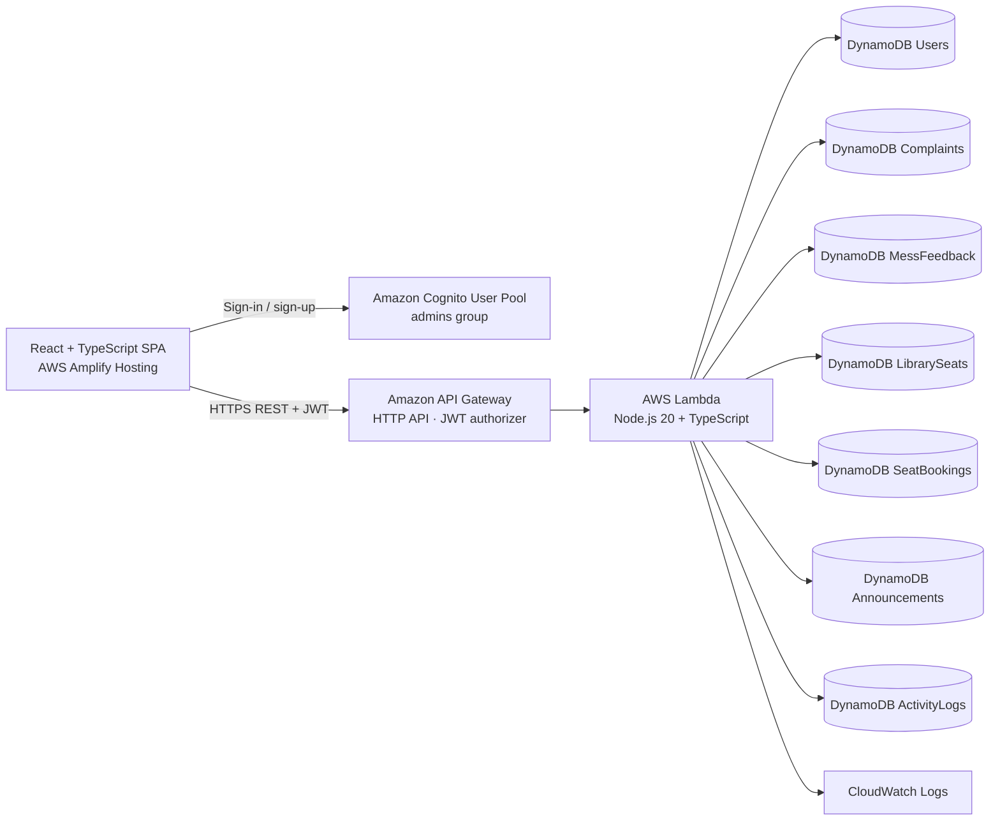

# CampusConnect architecture

## Runtime overview

**Request flow:** Cognito issues signed JWTs; API Gateway validates signature, issuer and audience before the Lambda executes. The Lambda reads identity from verified authorizer claims. For administration, it checks the `admins` Cognito group server-side. The browser's role display is not an authorization boundary. DynamoDB uses encryption at rest and IAM-scoped table permissions. Seat reservations use DynamoDB transactions and conditional updates.

## Deliberate scope choices

- Backend resources are defined in AWS SAM / CloudFormation, in a selected AWS region (suggested `ap-south-1`, Mumbai). All core backend services in this design are regional services; confirm current regional availability in the account before deploying.
- The production API uses API Gateway HTTP API, not the higher-cost REST API, and JWT auth instead of a custom authorizer.
- The project does not create S3, SNS, NAT Gateway, VPC, or always-on compute resources. Attachments and outbound notification delivery are intentionally omitted from this achievable first release; no dead upload/notification UI is shown.
- Static hosting is a separate Amplify Hosting setup. Amplify is not automatically provisioned by the SAM stack because a repository/branch and service-linked hosting access are needed. Do not publish a live URL until the deployment is verified.
- With no AWS credentials, the app starts in explicit **Local demo** mode and stores fictional seed records in browser localStorage. That is not an AWS simulation; the authenticated AWS path is activated only by setting the cloud configuration variables.

## Trust boundaries / security

1. Public browser code contains only Cognito pool/client IDs, API URL and region, which are identifiers, not secrets.
2. No AWS access key is used in the browser. API Gateway JWT authorization protects all application routes.
3. User/owner identifiers are derived from `requestContext.authorizer.jwt.claims.sub`; request-body owner IDs are ignored.
4. Student list queries are constrained to the owner's partition key. Administrator mutations check the Cognito `admins` group on every request.
5. The `admins` group is not self-service. A trusted account operator adds vetted user pool identities after deployment.
6. Complaint, meal rating, and announcement payloads are validated server-side, size-limited, and stripped of control characters.
7. Seat booking is a DynamoDB transaction: reserve only an available/expired seat, acquire one active booking per user, and write the booking record together. Conditional races return HTTP 409.
8. Cognito password policy requires 12 characters, mixed case, number and symbol. Email auto-verification is enabled; users complete the email confirmation step.
9. Lambda receives DynamoDB data-plane permissions only for the application's tables. No public table access or public S3 bucket is created.
10. CORS is constrained to the exact frontend origin supplied at deployment. Replace the localhost default before production.

## Operational limitations

- CloudWatch logs are emitted by Lambda; retention is not currently customized. Set an explicit short retention period if operating long-term, since logs can incur charges.
- Activity logs are append-only but the current UI does not yet expose an audit explorer.
- Demo data is synthetic and exists only in local browser storage. AWS tables start empty; use the supplied seed script after deployment if demonstration records are desired.
- No production URL, account, service resource, or deployment is claimed by this source tree.
